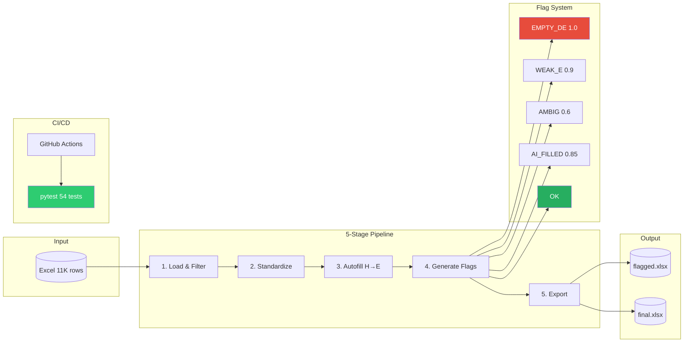

# Content DataOps Pipeline

콘텐츠 데이터의 품질을 **자동 검증 + 사람 검수**로 보장하는 파이프라인 모음. 두 개의 모듈이 같은 원칙을 서로 다른 데이터에 적용한다.

| 모듈 | 데이터 | 하는 일 | 상태 |
|---|---|---|---|
| [QA Flag Pipeline](#qa-flag-pipeline) (`src/`, `main.py`) | 남이 만든 대량 데이터 (조례 11,000+ rows) | 신뢰도 점수 기반 플래그로 고위험 행을 골라 사람이 먼저 검수 | 동작 중, pytest 54개 |
| [Grammar Graph](grammar_graph/README.md) (`grammar_graph/`) | 직접 만든 영어 학습 콘텐츠 | 문법 선수학습 그래프(YAML DAG)와 문항을 CI로 검증하고 로드맵 자동 생성 | 프로토타입 1 (그래프, 검증기, CI 완료 / 문항은 샘플 2개, 검수 진행 중) |

**공통 원칙**
- 기계가 확인할 수 있는 것은 CI로 자동 검증한다 (스키마, 순환, 정합성, 테스트).
- 내용이 맞는지는 사람이 검수하고, 검수 기록을 남긴다 (human-in-the-loop).
- LLM이 만든 데이터는 승인 전에는 쓰지 않는다.

**CI**: `CI` (QA 모듈: flake8, pytest, Docker 빌드) / `graph-validate` (그래프 모듈: 스키마, 순환, 도달성, 문항 태그, 로드맵 최신 여부)

---

# QA Flag Pipeline

Automated QA validation pipeline for large-scale regulatory data processing.

> **Problem**: 228개 지자체 × 50개 항목(11,000+ rows)의 조례 데이터를 
> 제한된 검수 인력으로 전수 확인하는 것이 불가능한 상황에서, LLM이 생성한 
> 데이터의 환각/오매칭을 사람이 놓치는 리스크가 있었습니다.
>
> **Approach**: 모든 행을 동일하게 검수하는 대신, 신뢰도 점수 기반 
> 플래그로 고위험 데이터를 분리해 사람이 우선 검토하도록 설계했습니다.
> (risk-based triage, human-in-the-loop)
>
> **Result**: 수작업 대비 검수 시간 70% 단축, pytest 54개 테스트 100% 통과

## diagram 



 

    
## Features

- **Flag Generation**: Detect data quality issues with confidence scores

각 플래그는 신뢰도 점수(0.6~1.0)를 가지며, 점수가 높을수록 사람 검토 우선순위가 높습니다.

  - EMPTY_DE: Completely unreviewed rows
  - WEAK_E: Insufficient evidence
  - AMBIG: Ambiguous cases
  - ATTACH: Attachment references
  - LAW_FIX: Law/regulation changes
  - NUM_FIX: Numeric value changes
  - AI_FILLED: Auto-filled from AI

- **Label Standardization**: Normalize D column variations
- **Auto-fill**: Fill empty E columns from AI-extracted data (H column)
- **Pipeline Orchestration**: Run all stages in order with progress tracking
- **Metrics**: Prometheus-client 기반 실행 지표 계측 (runs/rows/flags/duration)
- **Logging**: Structured JSON logging

## Installation

```bash
git clone https://github.com/kim-kyoungyeon/content-dataops-pipeline.git
cd content-dataops-pipeline
pip install -r requirements.txt
```

## Quick Start

```bash
# Run pipeline
python main.py data/input.xlsx

# With options
python main.py data/input.xlsx --output-dir ./results --range 4-1 5-2

# Skip autofill, output as JSON
python main.py data/input.xlsx --no-autofill --json
```

## CLI Options

| Option | Description |
|--------|-------------|
| `-o, --output-dir` | Output directory (default: output) |
| `--format` | Output format: xlsx or csv |
| `--no-standardize` | Skip label standardization |
| `--no-autofill` | Skip auto-fill from AI data |
| `--no-flag` | Skip flag generation |
| `--range START END` | Filter by item range (e.g., 4-1 5-2) |
| `-c, --config` | Custom config file path |
| `--json` | Output results as JSON |
| `-v, --verbose` | Verbose output |
| `-q, --quiet` | Errors only |

## Pipeline Stages
```
Input Excel
    |
    v
[1. Load] -- Read Excel file
    |
    v
[2. Filter] -- Optional: filter by item range
    |
    v
[3. Standardize] -- Normalize D column labels
    |
    v
[4. Autofill] -- Fill E from AI data (H column)
    |
    v
[5. Flag] -- Generate validation flags
    |
    v
[6. Export] -- Save flagged + final Excel
    |
    v
Output Files
```

## Project Structure

```
content-dataops-pipeline/
├── src/
│   ├── __init__.py
│   ├── config.py           # YAML config loader
│   ├── flag_generator.py   # Flag detection with confidence
│   ├── standardize.py      # D column normalization
│   ├── autofill.py         # E column auto-fill
│   ├── data_merger.py      # Merge/diff utilities
│   ├── pipeline.py         # Orchestrator
│   ├── logging_utils.py    # Structured logging
│   └── metrics.py          # Prometheus metrics
├── config/
│   └── config.yaml         # Configuration
├── tests/
│   ├── test_flag_generator.py
│   ├── test_standardize.py
│   └── test_pipeline.py
├── sample_data/
│   └── sample_input.xlsx
├── main.py                 # CLI entry point
├── Dockerfile
├── docker-compose.yml
├── Makefile
├── requirements.txt
└── README.md
```

## Configuration

Edit `config/config.yaml`:

```yaml
columns:
  city: "도시명"
  item: "항목명"
  status: "이상유무 및 수정값"    # D column
  content: "조항내용"            # E column
  ai_content: "조항내용.1"       # H column (AI)

validation:
  min_content_length: 40
  min_ai_content_length: 30
```

## Development

```bash
# Install dev dependencies
make install

# Run tests
make test

# Run linter
make lint

# Build Docker image
make docker-build

# Run in Docker
make docker-run
```

## Docker

```bash
# Build
docker build -t qa-pipeline .

# Run
docker run -v $(pwd)/data:/app/data qa-pipeline \
    data/input.xlsx --output-dir /app/output
```

## Metrics

When `prometheus-client` is installed, metrics are available:

- `qa_pipeline_runs_total{status}` - Total pipeline runs
- `qa_pipeline_rows_total` - Rows processed
- `qa_pipeline_flags_total{flag_type}` - Flags generated
- `qa_pipeline_stage_seconds{stage}` - Stage duration

## API Usage

```python
from src import run_pipeline, FlagType, process_dataframe

# Run full pipeline
result = run_pipeline("input.xlsx", output_dir="output")
print(f"Flagged: {result.final_stats['flagged_rows']} rows")

# Or use individual components
import pandas as pd
from src.flag_generator import process_dataframe, get_flag_statistics

df = pd.read_excel("input.xlsx")
flagged_df = process_dataframe(df)
stats = get_flag_statistics(df)
```

## Tech Stack

| Component | Technology |
|-----------|------------|
| Language | Python 3.10+ |
| Data | pandas, openpyxl |
| Config | PyYAML |
| Testing | pytest |
| Metrics | prometheus-client |
| Container | Docker |
| CI/CD | GitHub Actions |

## Roadmap (QA Flag Pipeline)

- **Phase B**: FastAPI + Streamlit 검수 현황 대시보드
- **Phase C**: 멀티 LLM 교차 검증 (Claude/GPT/gemini API) + 자동 리포트
- **Phase D**: Airflow 스케줄링 기반 정기 실행 자동화
